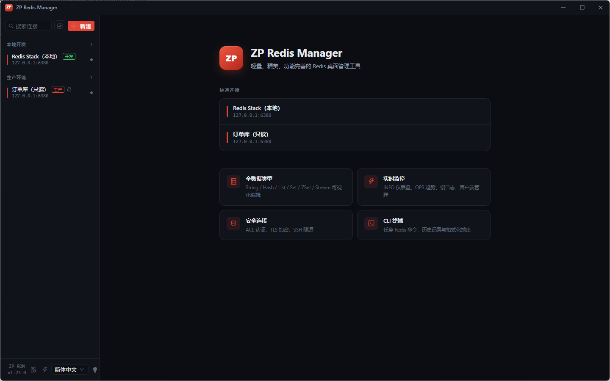
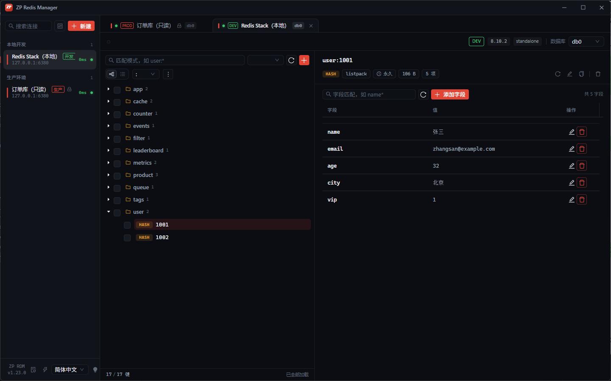
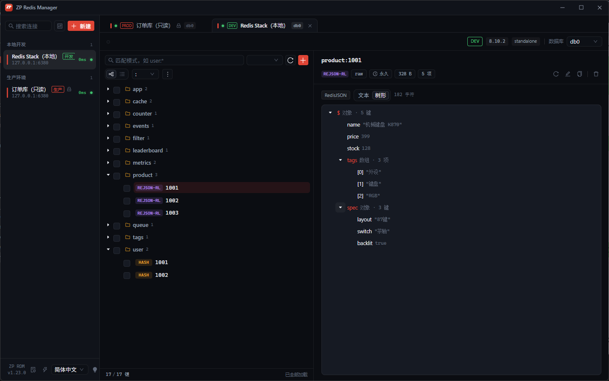
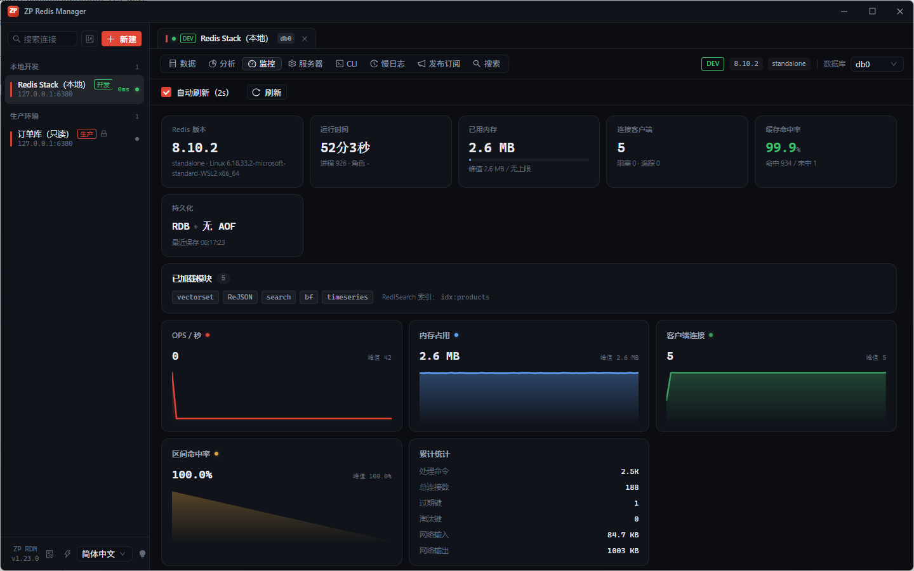
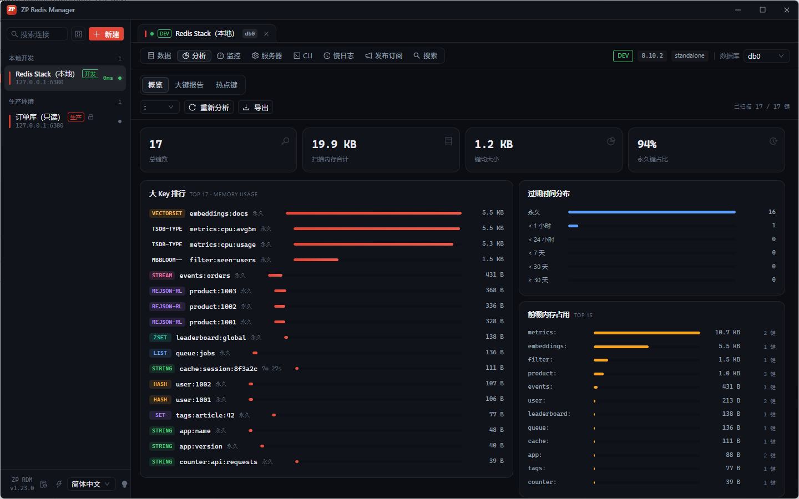
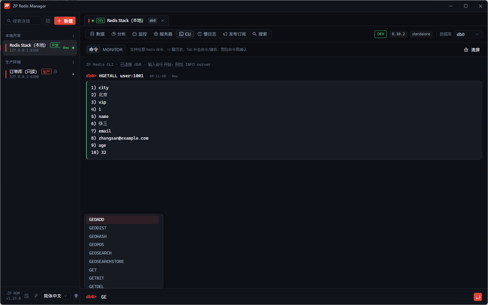
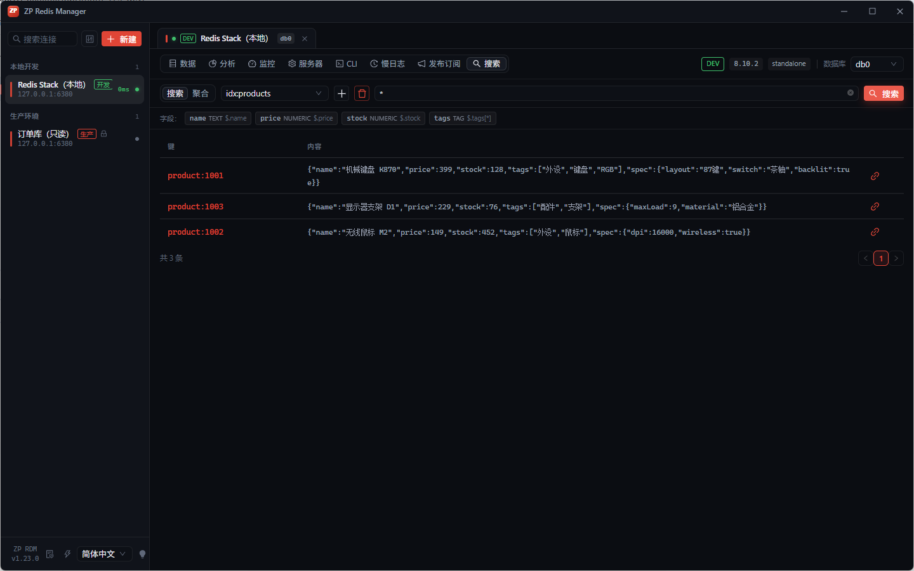
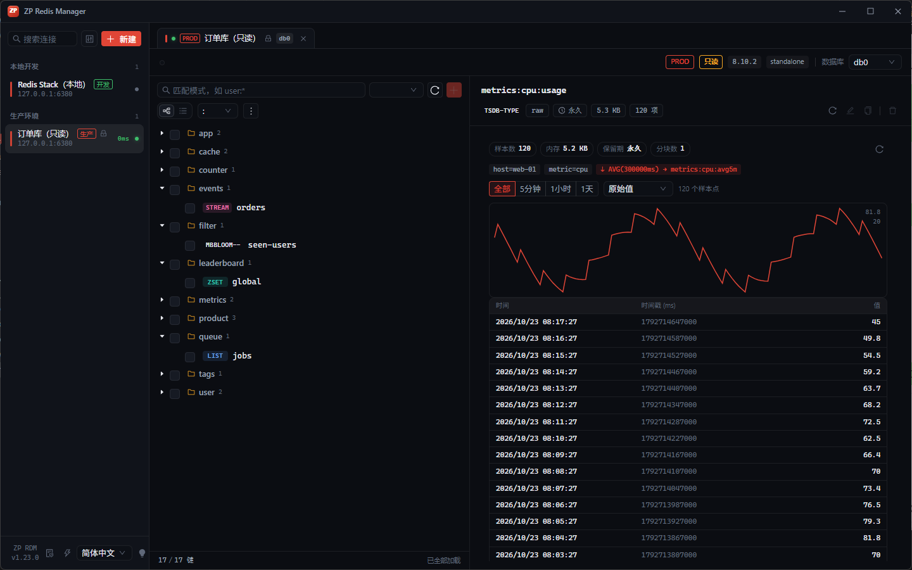
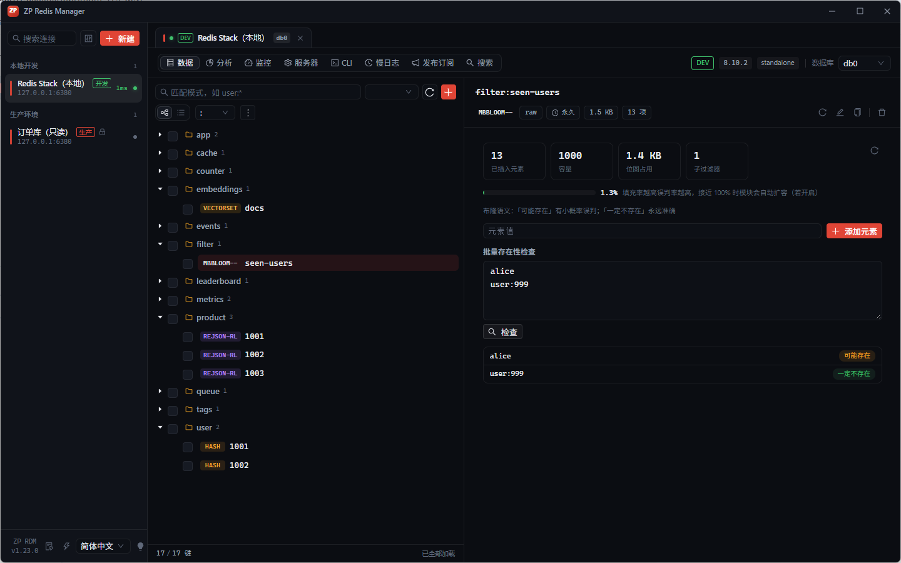
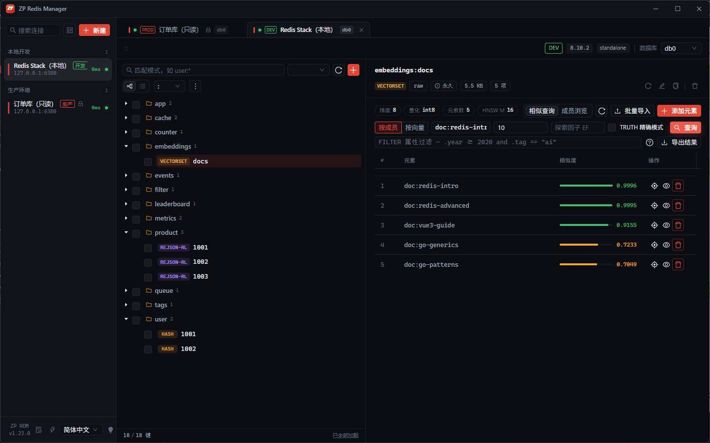

# ZP Redis Manager

**简体中文** | [English](README_EN.md)

轻量、精美、功能完善的 Redis 桌面管理工具。

基于 **Wails v2 + Vue 3 + TypeScript + Ant Design Vue**，单文件 exe，无运行时依赖，启动即连。


---

## 安装

从 [Releases](https://github.com/Cearl-gzy/zp-rdm/releases/latest) 下载对应平台：

| 平台 | 文件 | 说明 |
|---|---|---|
| Windows | `zp-rdm-amd64-installer.exe` | NSIS 安装包（推荐）；`zp-rdm.exe` 为便携版 |
| macOS | `zp-rdm-darwin-universal.zip` | Universal 二进制（Intel + Apple Silicon） |
| Linux | `zp-rdm-linux-amd64.tar.gz` / `.deb` | 需要 GTK3 + WebKit2GTK 运行时 |

也可以用包管理器安装：

```powershell
# Windows — winget
winget install Cearl-gzy.zp-rdm

# Windows — Scoop
scoop bucket add zp-rdm https://github.com/Cearl-gzy/scoop-bucket
scoop install zp-rdm
```

```bash
# macOS — Homebrew
brew tap Cearl-gzy/tap
brew install --cask zp-rdm

# Debian/Ubuntu — .deb
sudo dpkg -i zp-rdm-linux-amd64.deb   # 依赖 libwebkit2gtk-4.1-0，缺失时 apt --fix-broken install
```

**macOS**：应用未签名，首次打开需绕过 Gatekeeper：

```bash
unzip zp-rdm-darwin-universal.zip
xattr -cr zp-rdm.app   # 移除隔离属性
open zp-rdm.app
```

**Linux**： Debian/Ubuntu 安装运行时依赖后即可启动：

```bash
sudo apt install libwebkit2gtk-4.1-0
tar -xzf zp-rdm-linux-amd64.tar.gz && ./zp-rdm
```

> 🔐 跨平台加密：连接密码在三大平台均加密落盘——Windows DPAPI、macOS 钥匙串、Linux Secret Service（密钥环不可用时回退 0600 权限的本地密钥文件）。

---

## 功能总览

| 模块 | 能力 |
|---|---|
| 数据浏览 | 键树虚拟滚动、全类型编辑器、二进制 Hex、大值懒加载、批量 TTL/移动 DB、按模式批量删除 |
| 键分析 | TOP Keys、TTL 分布、前缀内存聚合、报告导出（JSON/CSV） |
| 监控 | OPS / 内存 / 客户端 / 命中率实时趋势、INFO 概览、客户端管理 |
| 运维 | 慢日志、LATENCY 延迟事件曲线、发布订阅（频道洞察 + 键空间事件流）、全命令 CLI（Tab 补全 + COMMAND DOCS 内联提示 + 收藏命令）、MONITOR 实时命令流 |
| 服务器管理 | 主从复制拓扑、CONFIG 运行参数查询/修改/REWRITE、ACL 用户管理（Redis 6+）、Lua 脚本缓存与 Redis Functions 管理、内存医生（MEMORY STATS/DOCTOR） |
| 模块 | RedisJSON 编辑器（文本/树形、路径级写入）、RediSearch 查询面板、TimeSeries 时序面板、Bloom Filter 面板、Redis 8 Vector Set 向量面板 |
| 数据迁移 | 选中键导出、整库导出、跨实例导入、跨连接复制 |
| 生产安全 | 只读连接模式（客户端层拦截写命令）、环境标签着色（生产/测试/开发）、写命令审计日志 |
| 集群 | Redis Cluster 连接、全节点聚合扫描、集群节点视图、hash slot 查询 |
| 哨兵 | Redis Sentinel 连接、故障转移自动跟随、多哨兵地址 |
| 工程化 | 全平台密码加密、TLS/mTLS 连接、工作区会话恢复、SSH 隧道、命令面板、自动更新、四语言界面（简中/繁中/英/日） |

---

## 界面截图

| 欢迎页 | 数据浏览（Hash 编辑器） |
|---|---|
|  |  |
| **JSON 树形编辑** | **监控大盘** |
|  |  |
| **键分析** | **CLI 终端（Tab 补全）** |
|  |  |
| **RediSearch 查询** | **TimeSeries 时序面板** |
|  |  |
| **Bloom Filter 面板** | **Vector Set 向量查询** |
|  |  |

---

## 功能详解

### 🌳 数据浏览

- **键树虚拟滚动** — 十万级键无压力。按分隔符（`:` `/` `.` `_` `-`）自动聚合成目录树，目录显示键数统计；树/列表双视图一键切换
- **全类型编辑器** — String / Hash / List / Set / ZSet / Stream 均有专属编辑器，支持字段级增删改、内联编辑；Stream 额外支持**消费者组管理**（组/消费者增删、pending 待确认列表、逐条 ACK）、**XRANGE 区间查询**与 **XAUTOCLAIM 待确认认领**（死信/卡死消息一键转移给消费者）
- **CodeMirror 编辑器** — String 值支持 JSON 语法高亮、格式化、压缩
- **二进制自动检测** — 含不可见字符的值自动切 Hex 视图，十六进制直接编辑，乱码不再困扰
- **大值懒加载** — 超过 1MB 的 String 默认只加载前 1MB 预览，一键加载全量，避免界面卡死
- **TTL 一目了然** — 键树上直接显示剩余 TTL，临期键（< 5 分钟）高亮警示
- **类型过滤 + 模式匹配** — `user:*` 模式搜索与类型筛选可叠加，SCAN 分页加载不阻塞
- **按模式批量删除** — ⋮ 菜单输入匹配模式（默认带入当前过滤词），输入防抖实时统计匹配键数，确认后 SCAN 分批删除；集群逐 master 直连扫描，只读连接由护栏自动拦截

### 📊 键分析

- **TOP Keys 排行** — `MEMORY USAGE` 采样统计前 20 大键，类型、大小、元素数一表看清
- **TTL 分布** — 永久 / <1h / <24h / <7d / <30d / ≥30d 六档柱状分布，快速发现过期策略问题
- **前缀聚合** — 按前缀（可自定义分隔符）聚合键数与内存占用，定位"哪个业务吃了内存"
- **大键扫描报告** — 可配键模式 / 采样上限（1万~20万）/ TOP N（20~200）的深度扫描：逐键 `MEMORY USAGE` + 元素数 + TTL，类型聚合分布，耗时与截断标记一目了然
- **热点键统计** — 双模式：① MONITOR 命令流采样（任意实例可用，客户端聚合读/写分离计数，独立连接不影响 MONITOR 视图，最长 300 秒自动停止）② `OBJECT FREQ`（LFU 淘汰策略下直读 Redis 访问计数，非 LFU 策略给出明确提示）
- **集群全量分析** — 集群模式下键分析/大键报告自动聚合全部 master 节点（逐节点直连 SCAN，键数为全集群 DBSIZE 汇总）
- **报告导出** — 概览分析 / 大键报告 / 热点键统计一键导出 JSON（完整结构）或 CSV（分区表格），留存归档或贴进工单

### 📈 监控大盘

- **四路实时趋势**（2 秒采样，SVG 迷你图）：
  - **OPS** — 每秒命令数
  - **内存** — used_memory 变化曲线
  - **客户端连接** — 连接数波动
  - **区间命中率** — 每个采样窗口的 keyspace hits/(hits+misses)，比累计命中率更灵敏
- **INFO 全景** — 服务器版本、运行模式、运行时长、键空间各 DB 分布
- **客户端管理** — `CLIENT LIST` 查看所有连接（地址/空闲时长/最后命令），可一键 KILL

### 🖥️ CLI 终端

- **全命令支持** — 任意 Redis 命令直接执行，结果按类型着色（状态/整数/数组/错误）
- **COMMAND DOCS 内联提示** — 输入命令名（含 CONFIG GET 这类子命令）即悬浮显示官方语法、一句话说明、引入版本与时间复杂度；文档来自服务器自身（Redis 6.2+），版本永远匹配，模块命令同样覆盖
- **历史持久化** — 命令历史跨会话保留（上限 200 条），↑↓ 翻阅，连续重复自动去重
- **收藏命令** — 输入行星标一键收藏/取消，工具栏收藏面板点击回填输入框、× 删除；跨会话持久化（上限 100 条）
- **危险命令护栏** — `FLUSHALL` / `FLUSHDB` / `SHUTDOWN` / `DEBUG` / `CONFIG SET` / `KEYS` 执行前弹确认框，防手滑
- **MONITOR 模式** — 实时命令流监听（独立连接，不占用连接池），支持暂停、关键字过滤、500 行滚动缓冲，闪烁指示灯明确监听状态

### 🧩 Redis 模块（Redis Stack）

- **RedisJSON 编辑器** — `ReJSON-RL` 键自动识别：文本模式（语法高亮/格式化）+ 树形模式（结构浏览）；树节点悬停即可**路径级编辑**（`JSON.SET key $.path`，局部写入不动 TTL）；模块加载时新建键可选 json 类型
- **RediSearch 查询面板** — 独立"搜索"视图：索引下拉（FT._LIST）+ schema 字段展示（名称/类型/JSONPath）+ 完整查询语法（`@field:value`、`@age:[18 30]`、`@city:{北京}`），结果分页直达数据视图
- **FT.CREATE 索引向导** — 图形化建索引：ON JSON/HASH、多键前缀、字段表（JSONPath/别名/类型 TEXT·TAG·NUMERIC·GEO/SORTABLE），JSONPath 末段自动填别名；索引可一键删除（可选 DD 连文档删）
- **FT.AGGREGATE 聚合面板** — 结构化构造聚合查询：过滤条件 + GROUPBY 多字段 + 聚合器（COUNT / COUNT_DISTINCT / SUM / AVG / MIN / MAX，自动别名），动态列结果表；复杂管线（LOAD/APPLY/SORTBY）可走 CLI 原生命令
- **TimeSeries 时序面板** — `TSDB-TYPE` 键自动识别：`TS.INFO` 概览（样本数/内存/保留期/分块数 + 标签与降采样规则标签）、区间预设（全部/5分钟/1小时/1天）+ 聚合查询（avg/sum/min/max/count/first/last + bucket 毫秒）SVG 折线图、最近样本表（倒序 50 条）、`TS.ADD` 追加样本（留空=服务端当前时间）；模块加载时新建键可选 ts 类型
- **Bloom Filter 面板** — `MBbloom--` 键自动识别：`BF.INFO` 概览卡片（已插入/容量/位图占用/子过滤器数）+ 填充率进度条（分级着色）、`BF.ADD` 添加元素（提示新增/可能已存在）、`BF.MEXISTS` 批量存在性检查（每行一个最多 100 个，「可能存在/一定不存在」语义标记）；模块加载时新建键可选 bf 类型

### 🧭 Redis 8 向量面板（Vector Set）

- **VSIM 相似查询** — 按成员（`ELE`）或原始向量（`VALUES`）检索：Top-K、EF 探索因子、`FILTER` 属性过滤表达式（语法速查 + 括号/引号配对校验）、`TRUTH` 精确模式（线性扫描校验 HNSW 召回质量）；结果按相似度排序，着色分数条一目了然，可一键导出 CSV / JSON
- **VLINKS 邻居图** — 成员详情抽屉内可视化 HNSW 图结构：环形布局按层展示（L0 最外圈），节点越大越相似、分数着色，点击任意邻居即以其为中心重绘，直观理解向量索引的连通性
- **批量向量导入** — JSONL（`{"element","vector":[...],"attrs"?}`，兼容 id/values/embedding 别名）与 CSV（首列元素 + 分量列，可选表头与 attrs 列）双格式，200 行管道批量写入、实时进度条、量化方式按 `VINFO` 自动适配，失败明细逐行列出
- **成员管理** — `VADD` 增删成员（FP32 向量 JSON + `SETATTR` JSON 属性 + NOQUANT/Q8/BIN 量化选项，已有集合量化方式自动适配）、`VRANDMEMBER` 随机采样浏览（向量集合无遍历命令）
- **向量与属性检视** — `VEMB` 查看近似向量（量化后为去量化值，一键复制）、`VGETATTR`/`VSETATTR` 在线编辑 JSON 属性
- **概览** — `VINFO` 维度/量化类型/元素数/HNSW 参数徽标，`VCARD` 计数；Redis 8+ 连接新建键可选 vectorset 类型（低版本自动隐藏）

### 🌐 Redis Cluster

- **集群连接** — 连接配置勾选「集群模式」即用 ClusterClient 接入（任一节点地址即可，自动发现拓扑），仅 db 0；TLS/SSH 隧道与单机配置完全复用
- **全节点聚合扫描** — 键浏览自动聚合全部 master 节点（服务端维护各节点 SCAN 游标，逐节点直连，规避客户端拓扑竞态漏扫）；键数为全集群 DBSIZE 汇总
- **集群视图** — 独立「集群」面板：cluster_state / slots_assigned / 节点数 / 键数概览，节点表展示角色（主/从）、slot 区间与数量、链路状态、当前节点标记
- **hash slot 查询** — 面板内输入任意键即算 `CLUSTER KEYSLOT`，写脚本/排查热点槽必备
- **跨槽兼容** — 批量删除自动拆分为逐键路由，绕开集群 CROSSSLOT 限制
- **已知限制**：MONITOR、CLI 自动补全仅覆盖单节点；RENAME 跨槽会报错（Redis 集群语义）

### 🛰️ Redis Sentinel

- **哨兵连接** — 连接配置勾选「哨兵模式」，填 Master 名称 + 哨兵地址（主机:端口为首个，可追加多个），go-redis FailoverClient 自动发现 master
- **故障转移自动跟随** — master 切换后客户端自动重连新 master，无需改配置；多 db 支持与单机一致
- **配置复用** — TLS/mTLS、SSH 隧道与单机配置完全复用（哨兵发现与数据连接均走同一 TLS/隧道）
- **已知限制**：哨兵自身认证（SentinelUsername/Password）暂不支持；连接的是 master，哨兵节点自身状态不在监控大盘展示

### 🐌 慢日志 & 发布订阅

- **SLOWLOG** — 慢查询列表（耗时/命令/时间/客户端），阈值说明，一键清空
- **LATENCY 延迟事件** — `LATENCY LATEST` 事件快照表（事件/最近发生/最近延迟/历史峰值，分级着色）+ `LATENCY HISTORY` 采样趋势曲线（最多 160 个点），与慢日志互补，快速定位命令/IO/fork 毛刺
- **Pub/Sub** — 任意频道订阅，消息流实时滚动，支持模式订阅（psubscribe）
- **频道洞察** — `PUBSUB CHANNELS + NUMSUB` 活跃频道列表带订阅者计数，点击频道一键订阅或设为发布目标；Redis 7+ 分片频道（SHARDCHANNELS）同步展示
- **键空间事件流** — `notify-keyspace-events` 标志位可视化配置（K/E/g/$/l/s/h/z/x/e/t/d/n/m 勾选 + 关闭/KEA/Ex 预设，CONFIG SET 保存），一键订阅 `__keyevent@db__:*`，事件流按类型着色（过期/淘汰红色、rename 紫色…），支持按键过滤、事件类型过滤与暂停

### 🛠️ 服务器管理

- **复制拓扑** — `INFO replication` 可视化：master 视角看下游副本列表（地址/状态/延迟秒数/落后字节数/偏移），副本视角看上游链路（状态/上次通信时间/是否同步中），复制积压缓冲用量一目了然；延迟分级着色预警
- **运行配置** — `CONFIG GET` 全参数搜索表（20+ 常用参数中文说明），`CONFIG SET` 图形化修改（高风险参数二次确认），一键 `CONFIG REWRITE` 持久化
- **ACL 用户管理** — 用户列表（状态/键/命令/频道/密码数），抽屉式规则编辑：on/off、nopass、密码设置/清除、键模式、命令类别、频道模式 + 附加原始规则，最终规则实时预览；default 用户修改强确认、防误删
- **脚本与函数** — Lua 脚本缓存面板：`SCRIPT LIST` 缓存浏览（Redis 8.2+）+ `SCRIPT LOAD` 在线加载（返回 sha1）+ `FLUSH`/`KILL`；Redis Functions 面板（Redis 7+）：函数库列表（引擎/函数数/标志位）、源码查看、`FUNCTION LOAD [REPLACE]` 注册、`FUNCTION STATS` 运行中函数监视与 `KILL`、库删除
- **内存医生** — `MEMORY STATS` 可视化：概览卡片（已用/峰值/RSS/碎片率分级着色/键数与平均每键字节）、数据集 vs 开销构成条、开销明细（启动占用/复制积压/客户端缓冲/AOF 缓冲/哈希表与过期开销/逐 DB 开销）、分配器统计（allocated/active/resident）；`MEMORY DOCTOR` 诊断结论卡片（健康/发现问题标记）；`MEMORY PURGE` 一键归还脏页；诊断报告 JSON 一键导出
- **已知限制**：集群模式不支持（配置/ACL 不跨节点同步，复制拓扑请用集群视图，均可 CLI 逐节点操作）；哨兵模式作用在 master 上可用

### 📦 数据迁移

- **选中键导出** — 勾选后导出 JSON（DUMP 序列化，全类型无损含二进制与 TTL）或 CSV（表格查看）
- **整库导出** — JSONL 流式导出（每行一键），带实时进度，大库导出期间界面可操作
- **跨实例导入** — RESTORE REPLACE 导入到任意连接/DB，同名键覆盖前确认
- **跨连接复制** — 值面板一键把当前键复制到另一个连接的指定 DB，支持重命名与 TTL 保留

### 🛡️ 生产安全

- **只读连接模式** — 连接配置勾选「只读模式」后，客户端层拦截**全部写命令**（SET/DEL/EVAL/CONFIG SET/FLUSHDB…含模块写命令与容器命令写子命令）：UI 编辑器写按钮自动禁用，CLI 执行写命令直接报错"只读模式"，管道含写命令整管中止，数据迁移/导入同样被拦截。覆盖所有写入路径（go-redis Hook 实现），是防手滑护栏（未知命令默认放行），非服务端安全边界——服务端请配合 ACL `+@read`
- **环境标签着色** — 连接可标记 生产（红）/ 测试（橙）/ 开发（绿）：侧栏连接项、标签页、视图头部全部显示彩色环境徽标，多个实例同开时一眼识别"这是生产库"
- **写命令审计** — 连接开启审计后，所有写命令（含参数，截断 300 字符）追加记录到本地 JSONL 日志（`配置目录/zp-rdm/audit/audit-日期.jsonl`），按天滚动；审计写入失败静默忽略，绝不阻塞正常命令
- **审计日志查看器** — 侧栏底部一键打开：按天/按连接过滤、命令与参数关键字搜索、危险命令（FLUSHALL/DEL/EVAL…）高亮、过滤视图一键导出 JSONL

### 🔐 安全与工程化

- **全平台密码加密** — 连接密码、SSH 私钥/密码/口令加密落盘（用户+机器绑定，拷走配置文件也解不开）：Windows DPAPI / macOS 钥匙串 / Linux Secret Service（AES-256-GCM 自包含密文，主密钥存系统密钥环）；旧版明文配置启动时自动迁移
- **TLS/SSL 连接** — 支持跳过校验（自签场景）、自定义 CA 证书严格校验、双向认证（mTLS 客户端证书/私钥），私钥随敏感字段加密落盘
- **SSH 隧道** — 连接支持 SSH 跳板（密码/私钥/口令三种认证）
- **工作区会话恢复** — 重启后自动恢复：打开的连接标签、激活标签、每连接的视图（数据/监控/CLI…）、选中的键、匹配模式、树/列表视图、键分隔符、上次使用的 DB
- **窗口状态记忆** — 尺寸、位置、最大化状态、侧栏宽度（可拖拽 160–480px）、深浅主题全部持久化
- **命令面板** — `Ctrl+K` 唤起，模糊搜索连接/视图/操作，全键盘流
- **自动更新** — 关于面板一键检查新版本；Windows 支持应用内自动安装：下载（**官方源 + 公共镜像多源竞速**，带进度、sha256 校验，镜像只能加速无法篡改；慢源/死源自动出局）→ 退出 → 弹一次 UAC 授权后提权静默安装到原目录（保留自定义安装位置）→ 自动重启新版（拒绝授权则回退启动旧版）；github.com 不可达时自动回退 API 下载通道。macOS / Linux 仍为浏览器下载（建议 brew / 包管理器）。注：自动安装面向 NSIS 安装版；绿色便携 exe 会被新安装实例替代
- **多语言界面** — 侧栏底部一键切换 简体中文 / 繁體中文 / English / 日本語，选择持久化，首次启动按系统语言自动判断（zh-TW/HK/Hant→繁体，ja→日语）；Ant Design 组件库文案同步切换（后端返回的 Redis 错误信息保持原文）
- **连接延迟感知** — 侧栏已打开连接实时显示 PING 往返时延（5 秒刷新，<50ms 绿 / <200ms 琥珀 / 更高红色），网络抖动一眼可见
- **连接分组管理** — 右键分组头重命名整组（已打开的连接不断线），连接菜单「移动到分组」支持既有分组与新建分组，分组折叠状态重启后保留，连接表单的分组字段自动补全已有分组名
- **精致 UI** — 无边框窗口 + 自定义标题栏、深色/浅色双主题、禁用右键菜单、禁用文本选择（终端区除外）

---

## 快捷键

| 键 | 功能 |
|---|---|
| `Ctrl+K` | 命令面板 |
| `Ctrl+N` | 新建连接 |
| `Ctrl+W` | 关闭当前标签 |
| `F5` / `Ctrl+R` | 刷新当前视图 |
| `↑` / `↓` | CLI 中翻阅命令历史 |

---

## 技术栈

- **后端**：Go 1.21+ / Wails v2.16 / go-redis v9 / DPAPI (CryptoProtectData)
- **前端**：Vue 3 / TypeScript / Pinia / Ant Design Vue 4 / CodeMirror 6
- **测试**：miniredis（内存 Redis 桩）+ 真实 Redis 集成测试（CI service container）
- **发布**：GitHub Actions 三平台构建（Windows NSIS / macOS universal app / Linux tar.gz → Release + 多平台更新清单）

## 开发

```bash
# 环境：Go 1.21+ / Node 20+ / Wails CLI v2.16
go install github.com/wailsapp/wails/v2/cmd/wails@v2.16.0

wails dev          # 开发模式（前端热更新）
wails build        # 构建 build/bin/zp-rdm.exe
wails build -nsis  # 构建 NSIS 安装包（需先 winget install NSIS.NSIS）
go test ./...      # 单元测试（miniredis，无需真实 Redis）
```

集成测试（DUMP/RESTORE 等 miniredis 不支持的命令）需要真实 Redis：

```bash
ZP_RDM_TEST_REDIS_ADDR=localhost:6379 go test ./...
```

RedisJSON / RediSearch / TimeSeries / Bloom 集成测试需要带模块的实例（Redis Stack 或加载了 redisearch + rejson + redisbloom + redistimeseries 的 Redis 8）：

```bash
ZP_RDM_TEST_JSON_ADDR=localhost:6380 go test ./...
# TimeSeries / Bloom 也可单独指定（缺省回退到 ZP_RDM_TEST_JSON_ADDR）：
ZP_RDM_TEST_STACK_ADDR=localhost:6380 go test ./...
```

> 未设置对应环境变量时相关测试自动跳过，不影响其余测试。

## 发布

push 一个 `v*` tag 即触发 GitHub Actions：全量测试 → 三平台并行构建（Windows NSIS + 便携 exe / macOS universal zip / Linux tar.gz + .deb）→ 自动创建 Release（含更新清单 `latest.json`，按平台匹配下载地址）。

Release 资产就绪后，跑一次 `scripts/update-channels.sh vX.Y.Z` 同步分发渠道：更新 [scoop-bucket](https://github.com/Cearl-gzy/scoop-bucket) 与 [homebrew-tap](https://github.com/Cearl-gzy/homebrew-tap) 的 manifest（自动算 sha256 并推送），并在 `packaging/winget/<version>/` 生成 winget-pkgs 清单（提交至 microsoft/winget-pkgs 的 `manifests/c/Cearl-gzy/zp-rdm/<version>/`）。

> tag 版本号必须与 `wails.json` 的 `info.productVersion` 一致（CI 会校验，不一致直接失败）。

## 数据与安全

- 配置目录：Windows `%AppData%/zp-rdm/`，macOS/Linux `~/.config/zp-rdm/`（`connections.json` + `settings.json`）
- 连接密码、SSH 私钥/密码/口令、TLS 客户端私钥：全平台加密落盘（Windows **DPAPI** / macOS 钥匙串 / Linux Secret Service，主密钥不可用时回退 0600 密钥文件），内存中保持明文
- 旧版明文配置启动时自动迁移为密文
- ⚠️ 连接**导出文件为明文**（可移植性设计），请妥善保管导出文件
- ⚠️ CLI 命令历史以明文保存在 `settings.json`，包含执行过的完整命令
